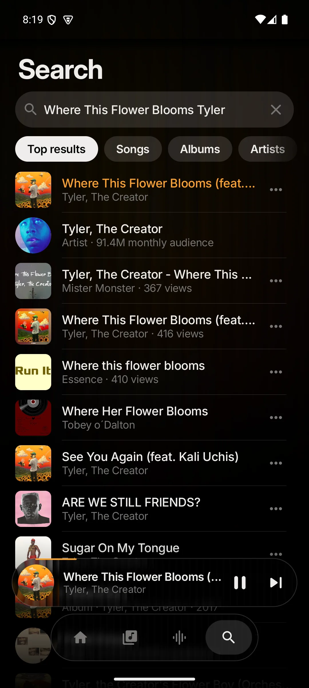
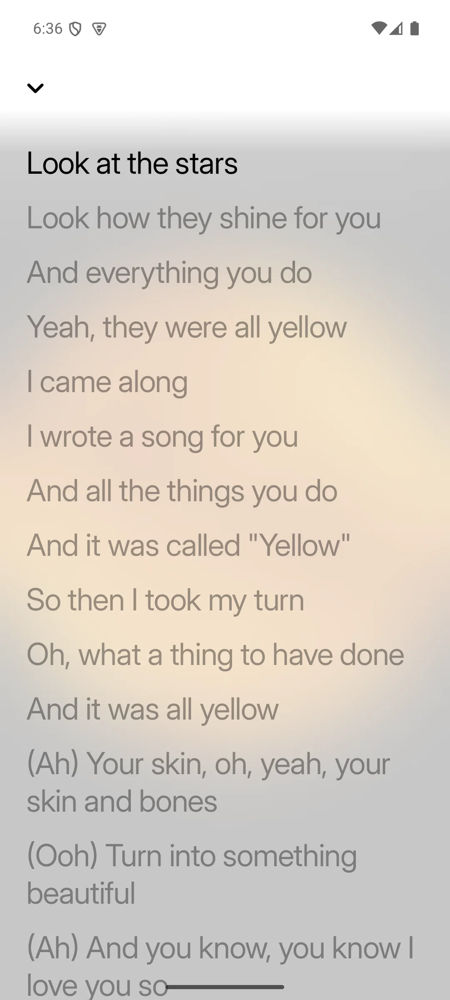

<div align="center">

# Verza

**A music player for Android. YouTube Music without the ads, covers that move in 3D, downloads in lossless, and lyrics in time.**

[](https://github.com/SambuddhaRoy/Verza/releases/latest)
[](https://github.com/SambuddhaRoy/Verza/releases/latest)
[](LICENSE)


&nbsp;

&nbsp;


**[Website](https://sambuddharoy.github.io/Verza-Next-releases/)** · **[Verza for Windows and Linux](https://github.com/SambuddhaRoy/Verza-Next-releases)**

</div>

---

Verza plays the YouTube Music catalogue without ads or a subscription. Sign in and your likes, playlists and Home come with you; skip it and everything except your account's library still works. There is no Verza server and no Verza account, and nothing is tracked.

It is one person's project, built in the open. It is not affiliated with or endorsed by Google or YouTube.

## Install

Download the APK from the [latest release](https://github.com/SambuddhaRoy/Verza/releases/latest) and open it. Android 8.0 or newer.

Verza isn't on Google Play, so Play Protect hasn't seen the file before and offers to scan it. Let it, then install. You also allow your browser or file manager to install apps, once. After that Verza fetches its own updates from GitHub.

## What it does

- **The whole catalogue**, full length, in the background, on the lock screen, over Bluetooth and in Android Auto.
- **3D covers.** A cover with someone in front of a scene gets depth, worked out on the phone. Tilt the phone and the scene slides behind them while they hold still.
- **Downloads in lossless.** Turn it on and a download becomes a FLAC from Soulseek, where people share their own rips; Verza makes the account for you. A file much smaller than the other copies of the same song is an MP3 dressed up as a FLAC, and Verza skips it. Downloads land in `Music/Verza`, filed by artist and album, as ordinary files any player can open.
- **Lyrics** that follow the song, line by line.
- **Home made from what you play**: recently played, mixes that start from an artist you've had on lately, and discovery radio for artists you haven't heard. **Your Sound** names your genre and plays it.
- **The music already on your phone** sits in the Library and plays in the same queue.
- **Flick it over.** With Verza on your computer, flick the phone toward the screen and the song carries on there, at the same second, queue and all. Flick it back and it returns to your pocket. The two talk over your Wi-Fi and to nobody else.
- An **equaliser** with as many bands as the phone has, a sleep timer that fades out, skip silence, five home-screen widgets and a quick-settings tile, ListenBrainz's weekly mixes, and two themes: pitch black, and stone.

## The design

Flat pages, pitch black at night and stone by day, with the playing cover flowing faintly behind them through fluted glass. What floats over the page, the dock and the player's keys, is clear glass ribbed in vertical flutes. Names are set in a bold sans, and everything else is plain. When a song starts, Verza takes the strongest hue on its cover and adjusts it until text in that colour reads at 4.5:1 against the page, then spends it in a few places only: the dock's rim, a switch that's on, the playing row.

The desktop app copies this design, so the two look and work alike.

## The source

Verza 2 is a rewrite from scratch. Its source is on the [`rewrite`](https://github.com/SambuddhaRoy/Verza/tree/rewrite) branch; `main` still holds the 1.x app it replaced. Same package and signing key, so 2.x installs over 1.x as an update and keeps its library.

```bash
git clone -b rewrite https://github.com/SambuddhaRoy/Verza.git
cd Verza
./gradlew :app:assembleDebug        # app/build/outputs/apk/debug/
```

JDK 17 and the Android SDK. A release build needs a `keystore.properties` in the project root pointing at your own signing key.

## Privacy

There is no backend. Nothing about how you use Verza reaches me, because there is nowhere for it to go.

Your sign-in is encrypted with a key held in the Android Keystore, kept out of backups, and sent only to YouTube. Listening history and playlists live on your phone and are used only to build your own Home and mixes. Lyrics lookups go to LRCLIB, and artwork and genre lookups to MusicBrainz and iTunes, with a song's title and artist and nothing identifying you. Soulseek is contacted only if you turn lossless on, ListenBrainz only if you connect it, and your computer only if you pair it.

## Licence

[Apache 2.0](LICENSE).
