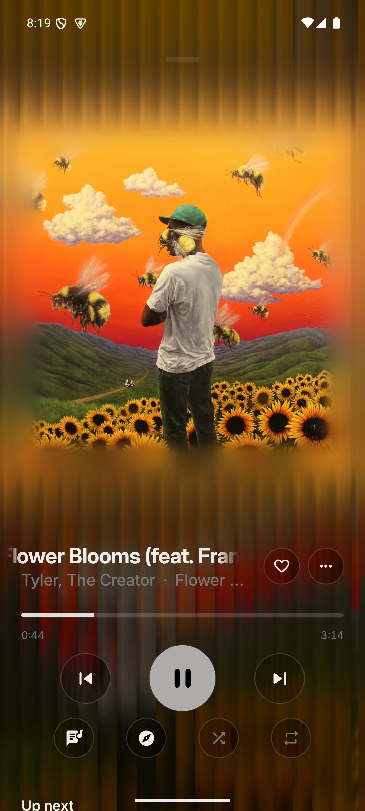

<div align="center">

# Verza

**All of YouTube Music. No ads.<br/>3D covers, lossless downloads and lyrics in time.**

[](https://github.com/SambuddhaRoy/Verza/releases/latest)
[](https://github.com/SambuddhaRoy/Verza/releases/latest)
[](LICENSE)


&nbsp;

&nbsp;


**[Website](https://sambuddharoy.github.io/Verza-Next-releases/)** · **[Verza for Windows and Linux](https://github.com/SambuddhaRoy/Verza-Next-releases)**

</div>

---

Verza plays all of YouTube Music with no ads and no subscription. Sign in to bring your likes, playlists and Home, or skip it. Nothing is tracked.

Verza is an independent project. It isn't affiliated with Google or YouTube.

## Install

Download the APK from the [latest release](https://github.com/SambuddhaRoy/Verza/releases/latest) and open it. Android 8.0 or newer.

Verza isn't on Google Play, so Android asks first. Let Play Protect scan it, then install. After that, Verza keeps itself up to date.

Or get it with [Obtainium](https://github.com/ImranR98/Obtainium):

[](https://apps.obtainium.imranr.dev/redirect?r=obtainium://add/https://github.com/SambuddhaRoy/Verza)

## What it does

- **No ads.** All of YouTube Music, full length, in the background and on your lock screen.
- **3D covers.** Tilt your phone in Now Playing and the cover moves in 3D. Android 13 and up.
- **Lossless downloads.** Save songs as FLAC, as good as the original recording.
- **Lyrics in time.** Follow along, line by line.
- **Made for you.** Home, mixes and Discovery radio, built from what you play.
- **Your own music.** Songs already on your phone play right alongside everything else.
- **Flick it over.** Flick your phone toward your computer and the song moves there.
- **Android Auto.** Your library and queue on your car's screen.
- **And more.** An equaliser, sleep timer, skip silence, widgets, a quick-settings tile, and two themes: black and stone.

## The source

Verza 2 is a rewrite from scratch. Its source is on the [`rewrite`](https://github.com/SambuddhaRoy/Verza/tree/rewrite) branch; `main` still holds the 1.x app it replaced. Same package and signing key, so 2.x installs over 1.x as an update and keeps its library.

```bash
git clone -b rewrite https://github.com/SambuddhaRoy/Verza.git
cd Verza
./gradlew :app:assembleDebug        # app/build/outputs/apk/debug/
```

JDK 17 and the Android SDK. A release build needs a `keystore.properties` in the project root pointing at your own signing key.

## Privacy

Verza has no servers, so nothing about how you use it reaches anyone. The full [privacy policy](PRIVACY.md) lists every service it talks to.

## Licence

[Apache 2.0](LICENSE).
